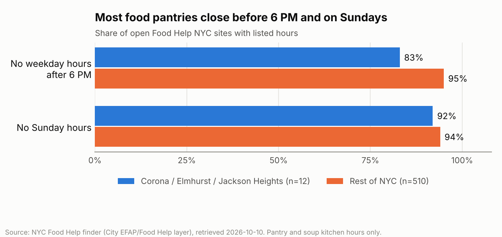
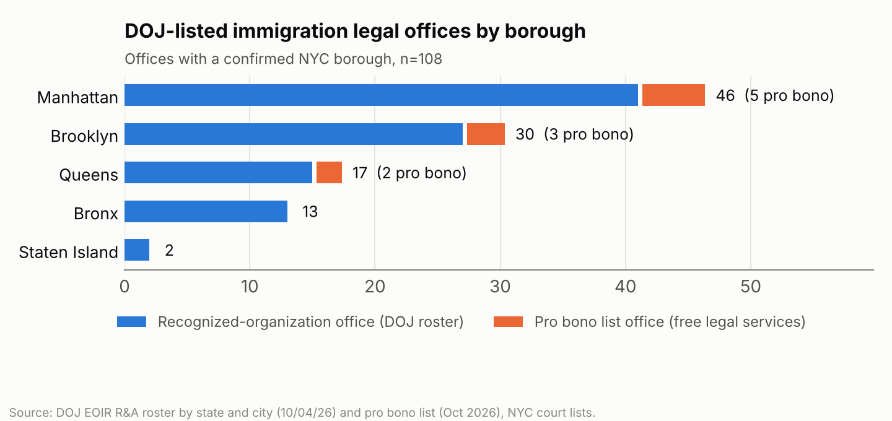

# Insights (data as of 2026-10-10)

## 1. Food pantries mostly close before 6 PM and on Sundays

In Corona, Elmhurst and Jackson Heights (ZIPs 11368, 11373, 11372), **10 of 12 food pantry and soup kitchen sites (83%) list no weekday hours after 6 PM, and 11 of 12 (92%) list no Sunday hours.** Across the rest of NYC the shares are 95% (485 of 510) and 94% (481 of 510).

- **Denominator:** open Food Help NYC sites whose City listing includes structured hours. Sites with no listed hours are excluded (0 in the demo zips, 1 elsewhere).
- **Source:** NYC Food Help finder's public data layer (Food_Help_Programs_PROD_view), retrieved 2026-10-10. `out/places.csv` rows `place-fh-*`.
- **Caveat:** these are listed hours, not visits. The small demo-zip count (12) makes its percentages sensitive to one site. Some sites run only certain weeks of the month, and 5 demo-area listings conflict with the City's own free-text schedule; they are flagged for manual review. Other food sources (WIC, SNAP retailers) are not counted.

## 2. DOJ-listed immigration legal offices are concentrated in Manhattan; Queens has 17

**NYC has 108 DOJ-listed immigration legal offices with a confirmed borough: Manhattan 46, Brooklyn 30, Queens 17, Bronx 13, Staten Island 2. Only 10 are offices on the DOJ pro bono list for the NYC immigration courts (Manhattan 5, Brooklyn 3, Queens 2).**

- **Denominator:** offices (not organizations) whose stated city and ZIP agree on a borough, with the geocoder's county agreeing wherever an address could be geocoded (102 of 108). Offices with conflicting location data (3), out-of-NYC pro bono offices, and individual accredited representatives are excluded.
- **Source:** DOJ EOIR Recognized Organizations and Accredited Representatives Roster by State and City (updated 10/04/26) and List of Pro Bono Legal Service Providers (October 2026). `out/places.csv` rows `place-doj-ro-*` and `place-doj-pb-*`.
- **Caveat:** "listed" is not "available". The roster does not say services are free, and neither list shows capacity, languages or wait times. Counts are not adjusted for population. Private immigration attorneys and organizations not on these DOJ lists are not counted.

