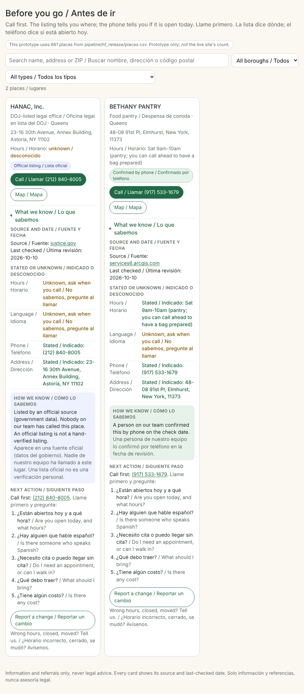

# Before you go / Antes de ir (prototype)

A static, from-disk prototype of place cards with a bilingual **"What we know / Lo que sabemos"** panel. It uses only fields already in `pipeline/hf_release/places.csv` (name, type, address, borough, hours, languages, phone, trust, source_url, last_checked). Nothing is inferred or invented.

This prototype uses 661 places from `pipeline/hf_release/places.csv`. That is this file's row count, not a count for the live site.

It does not touch the live Base44 app, HumHub, or `pipeline/`.

## Run it

Open `index.html` in a browser. No server needed. Data is embedded in `places-data.js`.

- Rebuild the data file after `places.csv` changes: `python3 prototypes/before-you-go/build-data.py` (from the repo root)
- Shortlist a few cards by id: `index.html#ids=place-fh-bethany-pantry,place-doj-ro-hanac-inc`

## What each panel shows

- **Source and date**: source host (linked) and `last_checked`.
- **Stated or unknown**: hours, language, phone, address. Blank fields read "Unknown, ask when you call / No sabemos, pregunte al llamar".
- **How we know**: `official` reads "Listed by an official source... An official listing is not a hand-verified listing." Only `verified` (one row today) reads "A person on our team confirmed this by phone." `unverified` reads "From the provider's own web page."
- **Next action**: call first, with five bilingual questions (open today, Spanish speaker, appointment, what to bring, cost).
- **Report a change** linking to `https://inmigracion-nyc.com/#/submit`.

## Test

```
PLAYWRIGHT_PKG=$(npm root -g)/playwright node prototypes/before-you-go/test-cards.mjs
```

Checks two cards and rewrites `screenshot.png`:

- Bethany Pantry (stated hours, language unknown, the one phone-confirmed row)
- HANAC, Inc. (DOJ roster, hours and language unknown, official listing, never called hand-verified)

Omit `PLAYWRIGHT_PKG` if `playwright` is installed locally. Set `CHROMIUM=/opt/pw-browsers/chromium` if Playwright cannot find a browser.

## 20-second script

> This is a place card. Before you go, open "What we know / Lo que sabemos." *(click)*
> Source and the date we checked. Then four facts, each marked stated or unknown. Here, hours are stated; language is unknown, so ask on the phone.
> This one is an official listing. That means a government source lists it. It does not mean we called. *(point to HANAC)* This one, we did call. *(point to Bethany)*
> Next step is always the same: call first, with these five questions in Spanish and English. If something changed, "Report a change" tells us.


